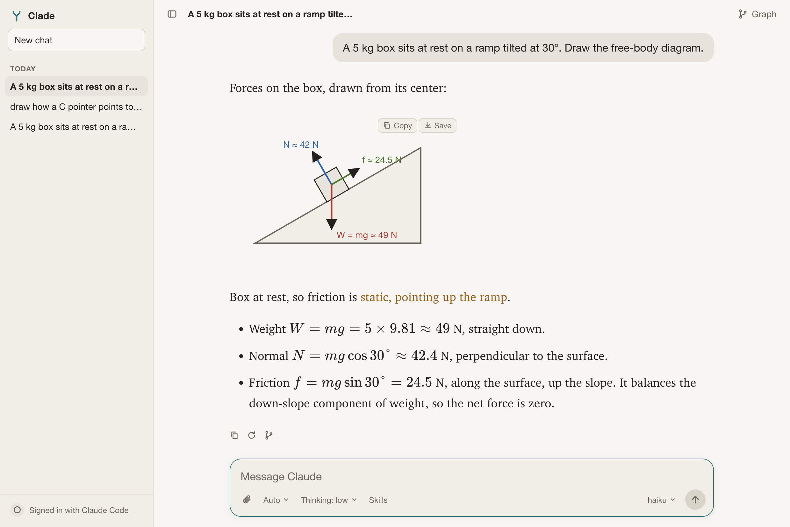
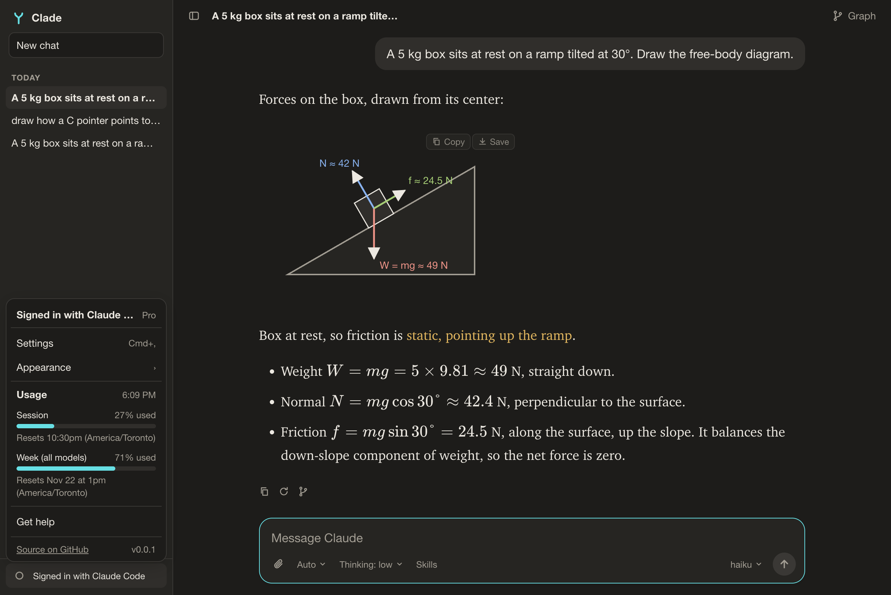

# Clade

A desktop chat window for Claude Code. It runs the real `claude` in a hidden
terminal and draws the conversation from the session file. No API, no login of
its own, no network access: the app only reads and writes local files and types
what you type.

```
npm install
npm start -- /path/to/project     # or pick a folder in the dialog
npm test
```

A drawing Claude made in the reply (Haiku, "Draw the free-body diagram"), light, and dark with the usage bars open:

| Light | Dark |
|---|---|
|  |  |

## What it does

- **Chat**: replies as open serif text, your messages in a bubble, tool steps
  folded into one line, code blocks with offline coloring and Copy, math
  (KaTeX), tables, callouts. A reply shows as plain text while Claude is still
  writing it, then switches to the drawn version.
- **Message box**: attach files (paperclip, drop, or paste an image; only the
  paths go to Claude Code), and pickers for the permission mode, thinking level,
  skills and model, all Claude Code's own. Send and Stop.
- **Chat list**: one line per chat. Branches and retries stay inside their chat.
- **Branching**: Copy, Retry and Branch under every reply; a version switcher
  where a reply has siblings; the reply graph (Cmd+G or pinch out).
- **Permission cards**: Claude Code's questions as cards with Allow / Deny.
- **Drawings**: Claude draws in the reply with a fenced `svg` block (forces,
  memory, graphs, circuits, flows). The app reads it with its own strict
  parser: only shapes and text survive (no script, handler, link, style text,
  image or outside font), colors are the app's own by name, text uses the
  interface font. While Claude writes, a quiet box of the same size holds the
  place. Copy and Save (a save dialog) on hover. A broken one shows as code.
- **Things Claude can write**: `{accent}text{/}` and ten more named colors,
  `{big}` / `{small}`, one big title (`# {fx=title}Title{/}`, 88 px, a soft
  accent glow under the cursor; old `fx=dither` and `fx=mono` draw the same),
  and shortcut blocks: `map` (a foldable tree; each node jumps to its
  heading), `mem` (memory boxes with pointer arrows), `timeline`, `compare`,
  `flow`. Names come from fixed lists; anything else shows as plain text or
  code.
- **Artifacts**: for things to keep, Claude writes one self-contained file to
  `artifacts/`; the side panel opens on it as soon as it is written or
  changed, and a card in the chat reopens it. The page runs in a sandbox with
  no network; Chart.js, D3 and KaTeX are bundled. Every save is kept as a
  version.
- **Light, dark and accents**: light, dark or system, and 9 accents, each a
  stored set of colors checked for contrast (4.5 or more), light and dark.
  Picked in Settings or the sidebar menu; no free color picker.
- **design.json**: the look (theme, fonts, type and spacing scales, colors,
  effects, panels) as data, live reloaded. Flat colors only.
- **Settings** (Cmd+,) and **zoom** (Cmd+Plus, Cmd+Minus, Cmd+0), kept in the
  app's own settings file, outside every project.
- **Terminal**: Cmd+J shows the real Claude Code terminal at any time.
- **Sidebar menu** (the account row at the bottom): your email and plan, read
  from `claude auth status` with all network access blocked (a Settings
  switch hides the email); Settings; Appearance; usage bars (session, week,
  and per model when Claude Code shows one), read from Claude Code's own
  `/usage` in the hidden terminal each time the menu opens; Get help (a help
  page drawn like a reply); one link to this repository; the version.

| Keys | |
|---|---|
| Cmd+U | attach files |
| Shift+Tab (in the message box) | next permission mode |
| Cmd+Shift+P / E / M / K | mode, thinking, model, skills |
| Esc | stop Claude |
| Cmd+, | settings |
| Cmd+G, Cmd+J | reply graph, terminal |

## Files the app writes in a project

| File | What |
|---|---|
| `design.json` | the look; created with defaults |
| `CLAUDE.md` | one marked section that tells Claude how to write replies, draw, and make artifacts |
| `branches.json` | which session was branched from which |
| `.claude/settings.local.json` | the permission-card hook, an allow rule for writes inside `artifacts/` only, and `skillOverrides` for skills you switch off |
| `attachments/` | images you paste into the message box |
| `.claude/skills/<name>/` | a skill you add from a folder |
| `artifacts/.versions/` | saved versions of artifacts |

Session files (`~/.claude/projects/...`) are only read; a branch is a new file.

## Source

| File | What |
|---|---|
| `src/main.ts` | main process: claude in a pty, sessions, branches, cards, wiring |
| `src/session.ts`, `branches.ts`, `graph.ts`, `chats.ts` | session parsing, branch files, reply graph, chat list (pure) |
| `src/cards.ts`, `hook.ts` | permission cards and the Claude Code hook |
| `src/design.ts`, `design-v2.ts`, `design-v1.ts` | design.json schema, contrast checks, older formats |
| `src/themes.ts` | the base surfaces and 9 accents as stored colors (pure) |
| `src/draw.ts` | the drawing parser, colors, preview size and save text (pure) |
| `src/usage.ts` | the `/usage` screen read down to limits (pure) |
| `src/account.ts` | `claude auth status` read down to email and plan (pure) |
| `src/colorcount.ts` | counts colors and sections in a reply, for the color-rule tests (pure) |
| `src/settings.ts`, `composer.ts`, `skills.ts` | app settings and claude flags, attachments, skills |
| `src/stream.ts` | reading the growing reply off the terminal screen |
| `src/markup.ts`, `highlight.ts` | tag, map, mem, timeline, compare, flow, table parsers and code coloring (pure) |
| `src/md.ts`, `diagrams.ts`, `renderer.ts` | the page: replies, drawings, diagrams and the interface |
| `src/artifacts.ts`, `artifact-host.ts` | artifact rules (pure) and the sandboxed panel |
| `src/claude-md.ts` | the CLAUDE.md section |
| `help.md` | the in-app help page |
| `docs/` | findings from tests, the polish plans, screenshots |

Debug switches: `CLADE_WINDOW=900x640` (start size), `CLADE_ARTIFACT_LOG=1`
(print blocked artifact requests), `CLADE_WHEEL_LOG=1` (print wheel events).
